# Architektura systemu

Ten dokument opisuje architekturę systemu zespołu. W Sprincie 1 powstaje diagram v0, który
będzie aktualizowany w kolejnych sprintach.

## Architektura docelowa (scaffold)

Tak wygląda system po sześciu sprintach — na poziomie warstw. To mapa odpowiedzialności,
a nie diagram do skopiowania: diagram v0 (niżej) rysujecie sami.

Relacje między warstwami (opis tekstowy, nie diagram):

- training: dane → pipeline Kedro → artefakt modelu
- serving: UI → API → model (artefakt wczytany przez API)
- state: API → persistence
- deployment: API + UI → Cloud Run

| Warstwa | Odpowiedzialność | Sprint | Miejsce w repozytorium |
|---|---|---|---|
| Dane i kontrakt | źródło danych, kontrakt, input normalization, training-only filtering | S1 | `data/01_raw/`, `src/asi_project/datasets.yaml`, `src/asi_project/data.py` |
| Pipeline | odtwarzalne przetwarzanie i trening od surowych danych | S2 | `conf/`, `src/asi_project/pipelines/` |
| Eksperymenty i artefakt | porównanie runów, wybór modelu, pakiet modelu ładowalny poza treningiem | S3 | W&B, pakiet modelu, `docs/model_card.md` |
| API | kontrakt usługi, walidacja na granicy, model wczytywany raz | S4 | `src/asi_project/api/`, `docker/` |
| Persistence | zapis predykcji poza procesem aplikacji (tryby `sql` / `disabled`) | S4 → S5 → S6 | repository w API, Postgres w compose |
| UI | formularz jako klient API | S5 | `ui/`, `docker/`, `docker-compose.yml` |
| Chmura | wdrożenie, sekret, logi, release | S6 | `deploy/`, Cloud Run, Secret Manager, Cloud Logging |

## Diagram v0 (Sprint 1)

Narysujcie, jak — według waszej obecnej wiedzy — będzie wyglądał system na koniec projektu.
Diagram v0 nie musi być poprawny w szczegółach; ma pokazać wasze rozumienie przepływu.
Sama lista warstw z sekcji wyżej nie wystarcza — diagram pokazuje wasz system i wasze decyzje.

Na diagramie zaznaczcie co najmniej:

- skąd pochodzą dane i gdzie żyje kontrakt danych;
- gdzie działa każdy z trzech typów przetwarzania: input normalization, training-only
  filtering, model preprocessing;
- gdzie powstaje model i jak trafia tam, gdzie wykonuje się predykcja;
- kto lub co wysyła żądanie predykcji i co dostaje w odpowiedzi;
- gdzie przechowywany jest stan (np. zapis predykcji);
- które elementy już istnieją po Sprincie 1, a które są planowane.

Diagram umieśćcie w bloku `mermaid` w sekcji poniżej (GitHub renderuje Mermaid w Markdown)
albo jako obraz w `docs/` z linkiem w tej sekcji. Usuńcie znaczniki TODO, gdy diagram będzie
gotowy — sprawdza to `python scripts/check_dod.py`.

```mermaid
flowchart LR
    subgraph DANE["Dane i kontrakt"]
        uci[("UCI: Online Shoppers<br/>CC BY 4.0")]
        dl["scripts/download_data.py"]
        raw[("data/01_raw/online_shoppers<br/>+ fingerprint.json")]
        contract["Kontrakt danych<br/>datasets.yaml + project.yaml<br/>target, ALLOWED / EXCLUDED"]
        uci --> dl --> raw
    end

    subgraph TRENING["Trening"]
        norm1["Input normalization<br/>normalize_input()"]
        filt["Training-only filtering<br/>filter_training_rows()<br/>braki targetu, duplikaty"]
        split["Split stratyfikowany<br/>train / test"]
        pipe["sklearn Pipeline<br/>model preprocessing<br/>imputer, scaler, one-hot<br/>+ LogisticRegression"]
        metrics[("metrics.json<br/>F1 vs Dummy")]
        norm1 --> filt --> split --> pipe --> metrics
    end

    subgraph ARTEFAKT["Artefakt modelu"]
        kedro["Pipeline Kedro<br/>S2"]
        pkg[("Magazyn modeli: data/06_models/<br/>model + metadata.json<br/>S3")]
    end

    subgraph USLUGA["Środowisko wdrożeniowe: Google Cloud Run + Secret Manager + logi (S6)"]
        client["System e-commerce / UI Streamlit<br/>S5"]
        api["API z tokenem<br/>S4"]
        norm2["Input normalization<br/>normalize_input()"]
        pred["Pipeline: model preprocessing<br/>+ predykcja"]
        db[("Postgres<br/>zapis predykcji<br/>S4-S5")]
    end

    raw --> norm1
    contract -.-> norm1
    contract -.-> pipe
    pipe -.-> kedro --> pkg
    pkg -->|ładowanie modelu| pred
    client -->|"sesja: cechy ALLOWED"| api
    api --> norm2 --> pred
    pred -->|"prawdopodobieństwo zakupu<br/>+ decyzja: pokaż rabat?"| api
    api -->|odpowiedź| client
    api --> db

    classDef done fill:#d4edda,stroke:#28a745,color:#000
    classDef planned fill:#f0f0f0,stroke:#999,stroke-dasharray:5 5,color:#555
    class uci,dl,raw,contract,norm1,filt,split,pipe,metrics done
    class kedro,pkg,client,api,norm2,pred,db planned
```

<!-- DIAGRAM-V0:START -->

Dane pobieramy z UCI, a kontrakt danych określa target i dozwolone cechy. Normalizacja wejścia działa w treningu i przy predykcji, filtrowanie rekordów tylko w treningu, a preprocessing modelu jest częścią Pipeline. Model trafia do API, które dostaje dane sesji ze sklepu i odpowiada, czy pokazać rabat, a predykcje zapisuje w bazie. Zielone elementy już istnieją, szare są planowane w kolejnych sprintach.

## Historia zmian architektury

| Sprint | Zmiana | Powiązany ADR |
|---|---|---|
| S1 | diagram v0 | — |
